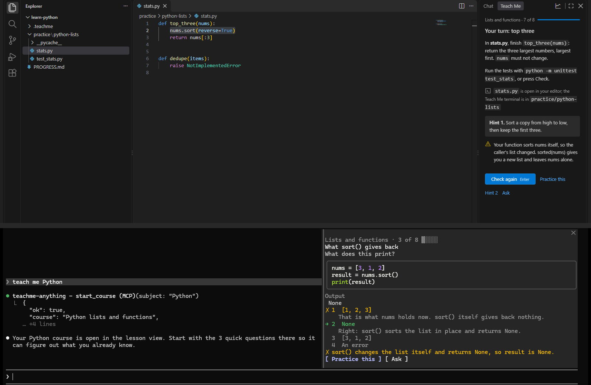

# Teach Me Anything

Learn any technical skill with Claude Code as your teacher, inside your own editor and terminal.
Every click answers at once, exercises are real and checked on your machine, and a mistake you make twice comes
back from a new angle until it is fixed for good.



## Quick start

1. Install the plugin in Claude Code:

   ```
   /plugin install teachme-anything --marketplace The-Hasanov/teachme-anything
   ```

2. Optional, for VS Code: build and install the extension (the lesson view sits in the secondary side bar).

   ```sh
   cd extension && npm install && npm run package
   code --install-extension teachme-anything-0.6.6.vsix
   ```

3. In an empty folder, tell Claude Code: **"teach me &lt;subject&gt;"**.

## What you get

- **Instant lessons.** A small engine runs the lesson: every answer, hint and next step shows in a few
  milliseconds, with no waiting for the model. The teacher works in the background, writing your next lesson.
- **Any subject.** Git, Python, SQL and Big-O are built in. Anything else is written for you while you answer three
  questions (about a minute), and every example and exercise is run on your machine before you see it.
- **Real practice.** Code is checked by tests, tools by the state they leave, queries by their results, theory by
  predicting, tracing and stepping through. One click installs what is missing.
- **Build with me.** Run `/teachme-anything:build-with-me`, then pick one of three projects that fit your level, or
  type your own. It becomes the next phase of your course. In each milestone the setup and tests are added for you,
  then you write the core.
- **Mistakes, fixed for good.** A wrong answer you made before gets a drill from a new angle. A fixed weakness is
  re-checked a day later, and every session starts with a short warm-up on what is due.
- **Your progress.** Accuracy, right at the first try, time per answer, a learning curve, your strengths and what
  to work on, all from your own answers. Press **Progress** in the lesson, or ask "how am I doing?".
- **Click, don't type.** Buttons and keys (1–8, Enter, H for a hint, A to ask, G for progress) for everything.
  **Ask** sends the step to Claude: the explanation shows in the chat and under the step, and you can type a question
  of your own there. Your place in the lesson is kept.
- **Pick up anywhere.** Progress is a log in `.teachme/`, one file per device: keep the folder in git and continue
  on another machine. `PROGRESS.md` shows where you are.

## Modes

| Mode | Needs | The lesson is |
|---|---|---|
| VS Code | the extension | a view in the secondary side bar; the exercise terminal and files open for you, and your own tabs and running terminals are left alone |
| Terminal | nothing extra | a pane beside the chat, with buttons |

## Privacy

Everything stays on your machine. The extension listens on `127.0.0.1` only, with a token; your course is plain
files in your course folder. Nothing is installed without your click, and the tutor never edits your code.

## Development

| Part | Folder | Role |
|---|---|---|
| Engine | `hooks/engine/` | lesson flow, grading, hints, weakness loop, FSRS reviews, mastery, statistics: pure functions over an event log |
| Host | `hooks/host/`, `hooks/lesson.tsx` | files, tool adapters, verification, the author agent, the pane, the VS Code channel |
| Courses | `courses/` | the built-in courses, in the same format the author writes |
| Extension | `extension/` | the lesson view, the layout manager, the channel to the plugin |
| Skills | `skills/` | progress, strengths and weaknesses on request in chat |

Run every test in one go with `sh scripts/check.sh` (`--quick` skips the extension). It runs:

```sh
claude plugin validate .
claude plugin test .                          # engine, schema, courses, pane
node extension/test/fsrs-ref.cjs              # FSRS against ts-fsrs
cd extension && npm install && npm test       # channel, layout lint, VS Code layout and focus
```

## License

MIT
