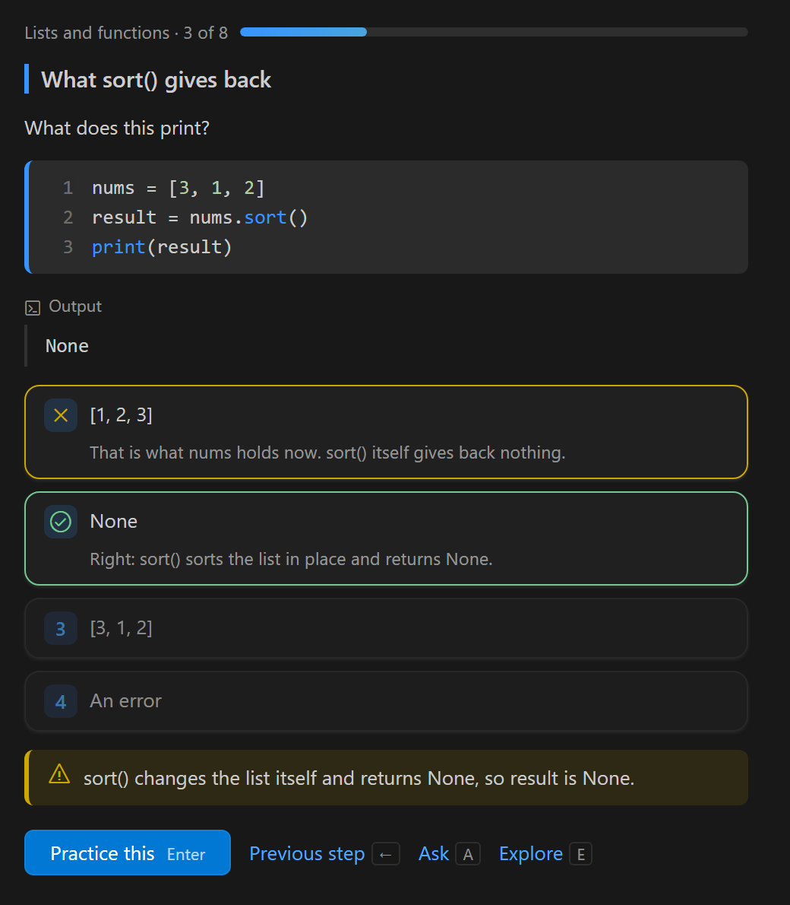

# Teach Me Anything

Learn any technical skill with Claude Code as your teacher, in your own editor and terminal.



## Quick start

1. Install the plugin in Claude Code:

   ```
   /plugin install teachme-anything --marketplace The-Hasanov/teachme-anything
   ```

2. Optional, for VS Code: build and install the extension.

   ```sh
   cd extension && npm install && npm run package
   code --install-extension teachme-anything-0.8.1.vsix
   ```

3. In an empty folder, tell Claude Code: **"teach me &lt;subject&gt;"**.

## What you get

- **A course written for you.** No ready-made courses: yours is planned from your answers and re-planned as you go.
- **Real practice.** Exercises run on your machine and are checked by tests. Missing tools install in one click.
- **Mistakes fixed for good.** A repeated mistake comes back from a new angle until it sticks.
- **Look back anytime.** Every finished lesson and reading stays one tap away on your path.
- **Explore freely.** Read any topic in depth, with no tests: press **Explore** or say "explore &lt;topic&gt;".
- **Learn a codebase.** In a repo, say "teach me this codebase".
- **Build with me.** Run `/teachme-anything:build-with-me` to learn by building a project.
- **Click, don't type.** Buttons and keys for everything. Your place is always kept.

## Modes

| Mode | Needs | The lesson is |
|---|---|---|
| VS Code | the extension | a view in the secondary side bar |
| Terminal | nothing extra | a pane beside the chat |

## Privacy

Everything stays on your machine. Nothing is installed without your click, and the tutor never edits your code.

## Development

Run every test with `sh scripts/check.sh` (`--quick` skips the extension).

## License

MIT
